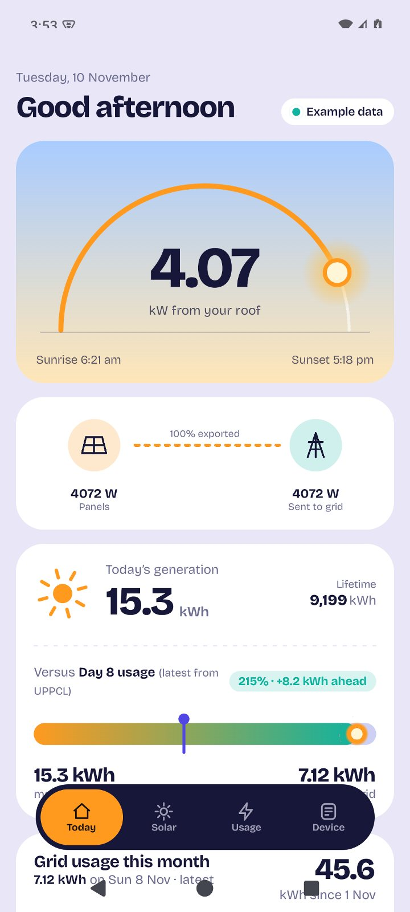
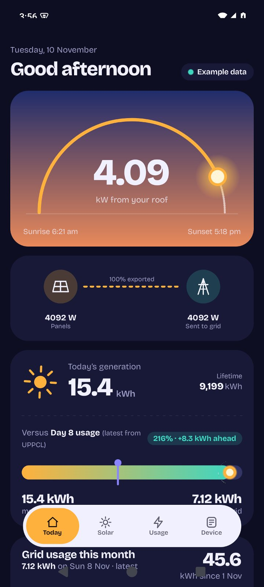
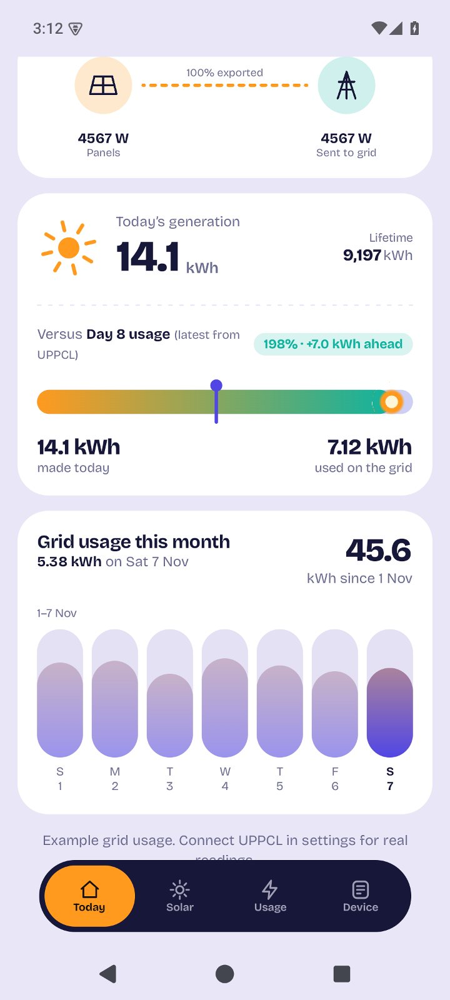
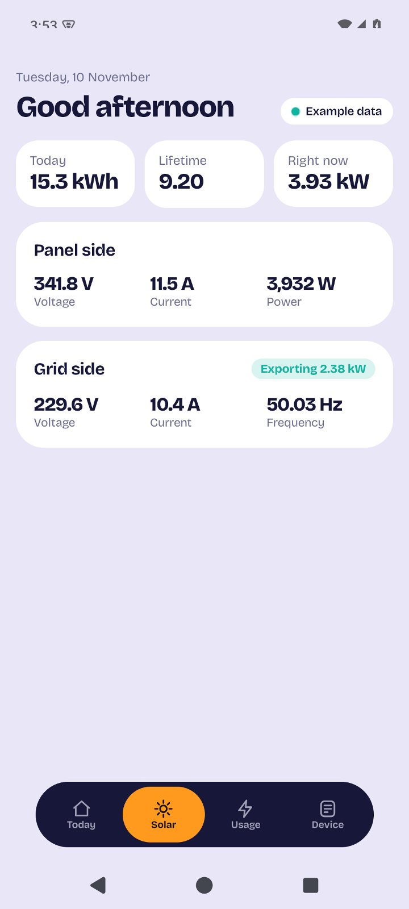
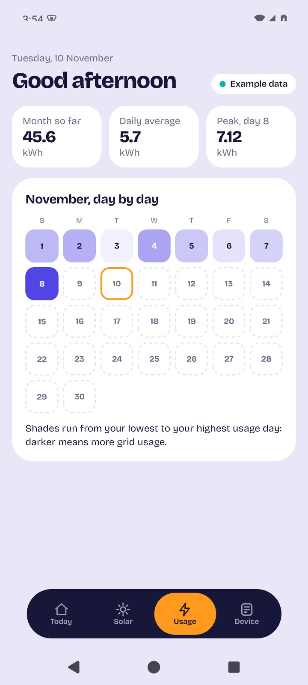
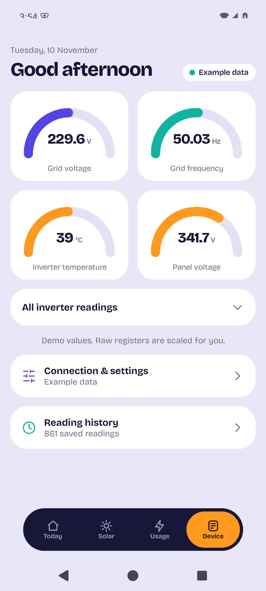
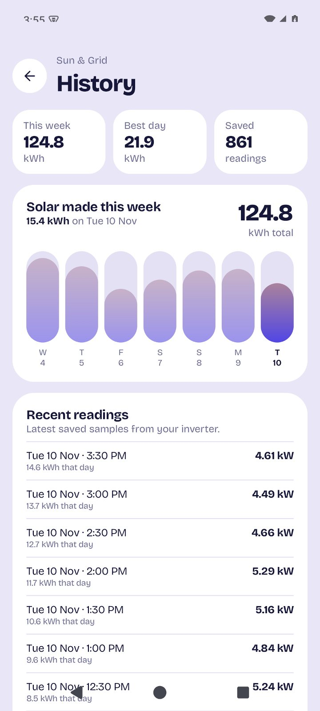
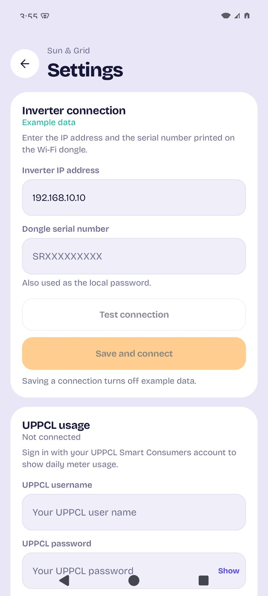

# Sun & Grid

A local-first Android dashboard for a **SolaX solar inverter** and an optional
**UPPCL smart meter** connection. Built with Kotlin, Jetpack Compose and
Material 3.

The interface keeps the important numbers large and the language plain: live
solar output, energy sent to the grid, month-to-date grid usage, history and
device health, with light and dark themes.

<p align="center">
  
  
  
</p>

<p align="center">
  <sub>Example data shown. The optional UPPCL card is fully local until you connect an account.</sub>
</p>

[](#requirements)
[](#project-structure)
[](#project-structure)
[](LICENSE)

## Features

- **Today** — live solar power, a sun-position arc for Lucknow, today's and
  lifetime generation, a comparison with the latest UPPCL day, and the
  month-to-date grid usage card.
- **Solar** — panel-side voltage, current and power, plus grid-side voltage,
  current, frequency and the current import/export direction.
- **Usage** — UPPCL month total, daily average, peak day and a day-by-day
  calendar heatmap. The compact chart on Today is swipeable across the weeks
  of the current month.
- **Device** — inverter gauges, every decoded register, connection settings and
  the local reading history.
- **History** — 7-day and 30-day generation totals, a bar chart, best day and
  the latest saved samples.
- **Local by design** — no account, cloud, analytics, ads or crash reporting for
  solar data. Inverter readings go directly from the Pocket Wi-Fi dongle to the
  phone over the LAN.
- **Background sampling** — WorkManager stores a reading every 15 minutes while
  the app is closed (optional).
- **Demo mode** — deterministic example data on first launch, so every screen
  works before any hardware is connected.
- **Themes** — system, light or dark.

## Screens

| | |
| --- | --- |
| <br>**Solar** | <br>**Usage** |
| <br>**Device** | <br>**History** |
| <br>**Settings** | <br>**Month-to-date grid usage** |

## Requirements

- Android 8.0 (API 26) or newer.
- A SolaX inverter with a Pocket Wi-Fi dongle on the same network as the phone.
- To build: JDK 17, Android SDK platform 35 and build-tools 35.0.0.

## Build and install

```bash
# from the project root
export JAVA_HOME=/path/to/jdk-17
./gradlew assembleDebug
adb install -r app/build/outputs/apk/debug/app-debug.apk
```

The debug application ID is `dev.amandevelops.solax.debug`, so it can be installed next
to a release build.

### Signed release

```bash
./gradlew checkReleaseApkSize
```

This builds the minified, resource-shrunk release APK and fails if it grows past
the **6 MB** budget. The current APK is about **1.8 MB**.

- Output: `app/build/outputs/apk/release/app-release.apk` when signed.
- Release signing is configured through a git-ignored `keystore.properties` file
  in the project root. The private keystore itself lives outside this repository.
- Without that file, `assembleRelease` still works but produces an unsigned
  `app-release-unsigned.apk`. Only the maintainer holds the release key.
- `dist/` is git-ignored and intended for local release binaries that you attach
  to a GitHub Release.

#### Signing setup (maintainer)

Generate a private key outside the repository:

```bash
mkdir -p ~/.android/keys
keytool -genkeypair -v \
  -keystore ~/.android/keys/sun-and-grid-release.p12 \
  -storetype PKCS12 \
  -alias sun-and-grid \
  -keyalg RSA -keysize 4096 -validity 10000
```

Then create `keystore.properties` in the project root:

```properties
storeFile=/home/you/.android/keys/sun-and-grid-release.p12
storePassword=<your-password>
keyAlias=sun-and-grid
keyPassword=<your-password>
storeType=PKCS12
```

Protect the file with `chmod 600 keystore.properties` and back up both the
keystore and its passwords. Neither file is tracked by Git, and CI never receives
the key; release APKs are built and signed locally by the maintainer.

## Connect your inverter

1. Join the same Wi-Fi network as the inverter dongle.
2. Open **Device → Connection & settings**.
3. Enter the inverter's local IP address (often `192.168.10.10` when connected
   directly to the dongle's access point, or the address assigned by your
   router).
4. Enter the dongle serial number. It is printed on the dongle and doubles as
   the local API password.
5. Tap **Test connection**, then **Save and connect**.
6. Saving a connection turns off **Example data** automatically.

If import and export are reversed on your firmware, open **More options** and
turn on **Swap grid direction**.

### Troubleshooting

| Symptom | Check |
| --- | --- |
| Timeout | Phone and dongle are on the same Wi-Fi; the IP is correct; the dongle is powered. |
| HTTP error | The dongle serial (password) is correct. |
| No live data | The inverter is awake and producing power. Some models stop responding overnight. |
| Grid values reversed | Turn on **Swap grid direction** under **More options**. |

## UPPCL grid usage

The optional UPPCL card shows the smart-meter reading next to your solar data.

1. Open **Device → Connection & settings** and find **UPPCL usage**.
2. Enter the username, password and account number you use in the UPPCL Smart
   Consumers app.
3. Tap **Test** to check the details, then **Save**.
4. Open **Today** or **Usage**. The month-to-date total and daily readings are
   fetched for the current UPPCL month.

The app calls only these endpoints:

- `POST https://uppcl.eeslsmartmeter.in/api/users/login` — signs in with the
  Base64-encoded password and returns a JWT.
- `POST https://uppcl.eeslsmartmeter.in/api/users/dailyGetData` — sends the JWT
  in the `token` header and returns every day of the requested month.

A successful response has HTTP 200 **and** `authCode: "200"`. UPPCL readings can
lag by 15–30 minutes. The app refreshes when it returns to the foreground and
keeps the month in memory for 10 minutes. It does not poll UPPCL in the
background.

Use **Disconnect UPPCL** to remove the stored credentials. Repeated wrong
sign-ins can temporarily lock a UPPCL account, so check the details before
saving; credentials are only saved after a successful test.

### Troubleshooting

| Symptom | Check |
| --- | --- |
| "Couldn't connect" on login | Use the username and password from the UPPCL app, not the web portal. |
| Login works but daily usage fails | The account number must be linked to that UPPCL login. |
| "Session expired" | Reopen the app; it signs in again once. If it keeps failing, disconnect and re-enter the credentials. |
| Month total is 0 | UPPCL has not published readings for this month yet. |
| Swipe chart shows the same week | Readings exist only for the current week so far; earlier weeks appear once UPPCL posts them. |

## How it works

### Local SolaX protocol

The app speaks the same local protocol as given in the Exploit [CVE-2023-35835](https://app.opencve.io/cve/CVE-2023-35835).

```http
POST http://<inverter-ip>/
X-Forwarded-For: 5.8.8.8
Content-Type: application/x-www-form-urlencoded

optType=ReadRealTimeData&pwd=<dongle-serial>
```

The dongle returns JSON with a `Data` array. The app maps these indices:

| Index | Meaning | Scale |
| --- | --- | --- |
| 0 | Grid voltage | × 0.1 V |
| 1 | PV1 current | × 0.1 A |
| 2 | Grid frequency | × 0.01 Hz |
| 3 | PV1 input power / inverter active power | W |
| 4 | PV1 voltage | × 0.1 V |
| 8 | Grid current | × 0.1 A |
| 11 | Grid active power | W (sign varies by firmware) |
| 13 | Total solar power | W |
| 19 | Total yield | × 0.1 kWh |
| 21 | Daily yield | × 0.1 kWh |
| 23 | Inverter temperature | °C |

Some firmware populates only index 3 and some only index 13 for live solar
power, so the app uses `max(Data[3], Data[13])`.

The wrapper documents the `X-Forwarded-For` bypass as
[CVE-2023-35835](https://app.opencve.io/cve/CVE-2023-35835). The inverter's web
service is not designed to be exposed to the internet. **Use this app only with
hardware you own, on your own network**, and never port-forward the dongle.

### Solar flow and grid sign

This installation is grid-tied with all PV output exported. The flow card
therefore mirrors the array output on the grid node and reads **100% exported**
while the panels are producing. At night, when the inverter reports no
generation, the card follows the grid meter and can show **From grid** instead.

The app treats **positive grid power as export** and negative as import. The
mapping varies across SolaX firmware and installation CT orientation, so the
sign can be flipped under **More options → Swap grid direction**.

### Data and privacy

- No SolaX account, cloud API, analytics, ads or crash reporting.
- Settings are stored with AndroidX DataStore.
- History is stored as `history.json` in the app's private files directory.
- Android backups are disabled, so credentials and readings do not leave the
  device through Google backup.
- Samples are logged at most every 2 minutes; history is pruned to 75 days and a
  maximum of 6,000 samples.
- Cleartext HTTP is allowed only because the dongle's local API does not support
  HTTPS. Inverter readings never leave your network.
- If you enable UPPCL usage, the username, password and account number are
  stored in app-private DataStore storage. They are sent only to
  `uppcl.eeslsmartmeter.in` in the login request; no solar readings or history
  are sent to UPPCL. Disconnect removes them.

## Project structure

```text
app/src/main/java/dev/amandevelops/solax/
├── MainActivity.kt
├── data/
│   ├── Analytics.kt          # daily aggregation, grid calculations
│   ├── ConnectionTest.kt     # connection test results
│   ├── DemoData.kt           # deterministic simulator
│   ├── HistoryRepository.kt  # JSON sample log
│   ├── Reading.kt            # live snapshot model
│   ├── SettingsRepository.kt # DataStore preferences
│   ├── SolaxClient.kt        # OkHttp local API client
│   ├── SolaxParser.kt        # Data[] mapping
│   ├── SyncWorker.kt         # 15-minute background sampling
│   ├── UppclClient.kt        # UPPCL login, JWT, daily usage
│   ├── UppclModels.kt        # UPPCL response models
│   └── UppclRepository.kt    # session and month cache
└── ui/
    ├── MainViewModel.kt      # polling, history and connection state
    ├── SolaxApp.kt           # four-tab scaffold, settings and history routes
    ├── SunTimes.kt           # Lucknow sunrise/sunset calculation
    ├── UsageMonth.kt         # UPPCL month and week grouping
    ├── components/           # cards, icons, charts, flow diagram
    ├── screens/              # Today, Solar, Usage, Device, History, Settings
    └── theme/                # colour, type, shapes
```

**Why no Room?** A few thousand small samples do not justify the dependency,
schema and build-size cost. A single JSON file with an in-memory cache is enough
for this app's read pattern and keeps the release APK small.

**Typography:** the app bundles [Bricolage Grotesque](https://github.com/ateliertriay/bricolage)
under the SIL Open Font License. See [`THIRD_PARTY_NOTICES.md`](THIRD_PARTY_NOTICES.md)
and [`LICENSES/OFL-1.1.txt`](LICENSES/OFL-1.1.txt).

## Tests

```bash
./gradlew testDebugUnitTest
```

The **28 unit tests** cover the protocol parser (scaling, missing indices,
invalid payloads), daily aggregation, grid sign inversion, period totals,
example-data determinism, UPPCL month/week grouping, and the UPPCL client
(Base64 login, JWT claims, daily parsing, error kinds, session and month
caching).

## Version

The current release is **1.0.0** (versionCode 1). See
[`CHANGELOG.md`](CHANGELOG.md) for the release notes.

## Credits

- Local API protocol and field mapping:
  [amandevelops/solax-python-wrapper](https://github.com/amandevelops/solax-python-wrapper).
- Bricolage Grotesque by Mathieu Triay.
- Built with Jetpack Compose, Material 3, OkHttp, DataStore and WorkManager.

## License

[MIT](LICENSE) © 2026 AmanDevelops

This is a personal project, not affiliated with SolaX Power or UPPCL. Use it at
your own risk; grid and inverter readings are provided for information only.
